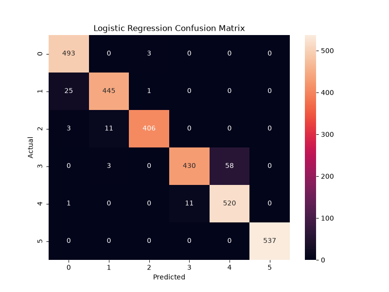
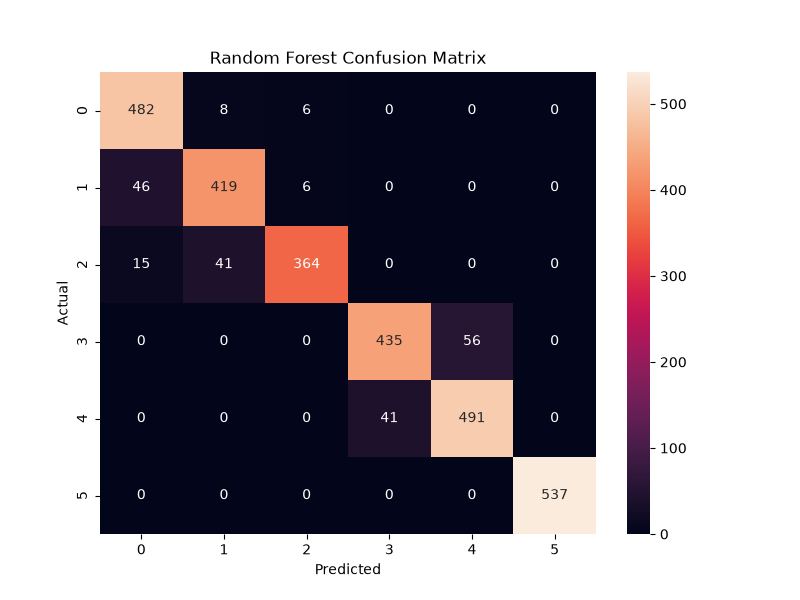
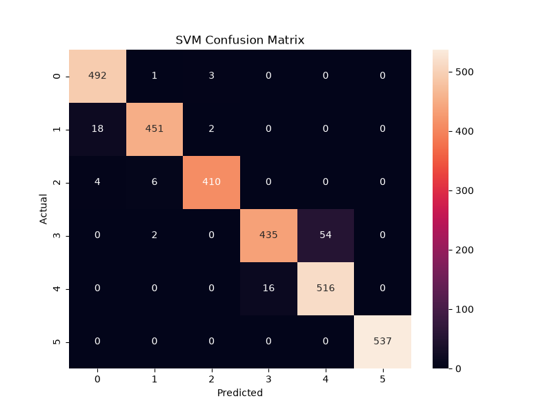
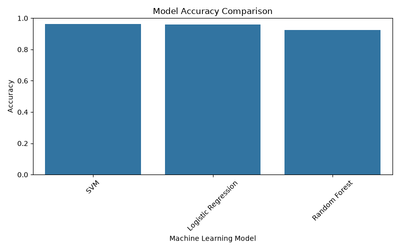

# Human Activity Recognition Using Smartphone Sensors

A Machine Learning based system that recognizes human activities using smartphone sensor data.

<p align="center">


</p>

---
## 👥 TEAM 19 ROLE , PPT AND VIDEO LINKS 

| Name | GitHub Handle | Contribution |
|---|---|---|
| Amaan | CHADMONK07 | Project Lead, Prediction Pipeline, Integration |
| Jai | 2026eeb1355-spec | Model Training Pipeline |
| Atulya | Atulya-Sharma28 | Model Evaluation & Visualization |
| Thanish | 2026aib1029-cyber | Prediction Pipeline & Documentation |

## 🎥 Project Demo Video

The complete project demonstration can be viewed through the following videos:

### Video 1: Complete Project Installation,Member Introduction And Contribution

[Watch Video 1](https://youtu.be/469n0J2X-Is)


### Video 2: Project Explanation and Code Walkthrough

[Watch Video 2](https://youtu.be/BvkJuBUtOEY)

## 📊 Project Presentation

The project presentation slides can be accessed below:

[Download Project PPT](presentation/HAR_Project_GitHub.pdf)
---

## 🚀 Project Overview

Human Activity Recognition (HAR) is a machine learning problem where the objective is to identify human activities based on sensor data collected from smartphones.

In this project, we use accelerometer and gyroscope measurements from smartphones to classify six different human activities:

- Walking
- Walking Upstairs
- Walking Downstairs
- Sitting
- Standing
- Laying

Multiple machine learning algorithms are trained and evaluated to build an accurate activity recognition system.

---
## 📌 Problem Statement

With the rapid growth of wearable devices and smartphone-based applications, automatically understanding human activities has become an important task in healthcare, fitness monitoring, smart environments, and safety systems.

Smartphones contain built-in sensors such as accelerometers and gyroscopes that continuously capture human movement patterns. However, converting this raw sensor data into meaningful activity information requires efficient data processing and machine learning techniques.

The objective of this project is to develop a machine learning model capable of accurately recognizing human physical activities from smartphone sensor measurements.

---
## 🎯 Objectives

The main objectives of this project are:

- To analyze smartphone sensor data collected during different human activities.
- To preprocess and prepare sensor data for machine learning applications.
- To train multiple classification models and compare their performance.
- To evaluate models using accuracy, classification reports, and confusion matrices.
- To develop a prediction pipeline capable of identifying human activities from sensor inputs.
- To select the best-performing model for activity recognition.

---


## 📂 Dataset Description

This project uses the **UCI Human Activity Recognition Using Smartphones Dataset**.

The dataset was created from experiments carried out using smartphone sensors to record human movement patterns. Data was collected from participants performing different daily activities while carrying a smartphone equipped with an accelerometer and gyroscope.

### Dataset Setup

The dataset is automatically downloaded and extracted using the provided script:

```bash
python src/download_data.py
```

The script creates the required folder structure:

```
data/
└── raw/
    └── UCI HAR Dataset/
        ├── train/
        ├── test/
        ├── features.txt
        └── activity_labels.txt
```

This ensures that the machine learning pipeline can directly access the required sensor data for training and evaluation.

### Dataset Information

| Attribute | Description |
|-----------|-------------|
| Dataset Name | Human Activity Recognition Using Smartphones Dataset |
| Source | UCI Machine Learning Repository |
| Data Type | Smartphone sensor measurements |
| Sensors Used | Accelerometer and Gyroscope |
| Number of Features | 561 |
| Number of Activities | 6 |
| Learning Task | Multi-class Classification |

---

## 🏃 Activity Classes

The model classifies the following six activities:

| Class | Activity |
|------|----------|
| 1 | Walking |
| 2 | Walking Upstairs |
| 3 | Walking Downstairs |
| 4 | Sitting |
| 5 | Standing |
| 6 | Laying |

---

## 📊 Dataset Features

The dataset contains **561 numerical features** extracted from smartphone sensor signals.

These features include:

- Time-domain measurements
- Frequency-domain measurements
- Accelerometer features
- Gyroscope features
- Body and gravity motion components

Examples of extracted features:

- Mean acceleration values
- Standard deviation of movement
- Signal magnitude information
- Frequency-based sensor characteristics

These engineered features help machine learning algorithms identify unique patterns associated with different human activities.

---
## 🔄 Project Workflow

The complete workflow of the Human Activity Recognition system is shown below:
```text
Smartphone Sensor Data
          |
          ↓
Data Loading
          |
          ↓
Data Preprocessing
          |
          ↓
Model Training
          |
          ↓
Model Evaluation
          |
          ↓
Human Activity Prediction
```
---

## 🏗️ Machine Learning Pipeline

### 1. Data Loading
- Sensor data is loaded from the UCI HAR dataset.
- Training and testing datasets are separated.

### 2. Data Preprocessing
- Feature names are assigned.
- Data is prepared in a format suitable for machine learning algorithms.

### 3. Model Training
Three classification algorithms are trained:

- Logistic Regression
- Random Forest
- Support Vector Machine (SVM)

### 4. Model Evaluation
Models are evaluated using:

- Accuracy score
- Classification report
- Confusion matrix

### 5. Prediction
The best-performing model is used to predict human activities from new sensor input.

---
## 📁 Repository Structure

The project is organized as follows:


### Folder Description

| Folder/File | Purpose |
|------------|---------|
| `data/` | Contains dataset files |
| `models/` | Stores trained machine learning models |
| `notebooks/` | Contains exploratory data analysis notebooks |
| `outputs/` | Stores evaluation results and visualizations |
| `src/` | Contains project source code |
| `requirements.txt` | Lists required Python libraries |
| `README.md` | Project documentation |

---

## 🛠️ Technologies Used

### Programming Language

- Python

### Data Processing

- Pandas
- NumPy

### Machine Learning

- Scikit-learn

### Data Visualization

- Matplotlib
- Seaborn

### Development Tools

- Jupyter Notebook
- VS Code
- Git & GitHub

---
## ⚙️ Installation & Setup

Follow the steps below to run this project locally.

### 1. Clone the Repository

Clone the GitHub repository:

```bash
git clone https://github.com/CHADMONK07/Human-Activity-Recognition-Using-Smartphone.git

cd Human-Activity-Recognition-Using-Smartphone
```

### 2. Create Virtual Environment

Create a Python virtual environment:

```bash
python -m venv venv
##for mac use python3 -m venv venv
```

Activate the virtual environment:

**Windows**

```bash
venv\Scripts\activate
```

**Linux / macOS**

```bash
source venv/bin/activate
```

### 3. Install Dependencies

Install all the required Python libraries:

```bash
pip install -r requirements.txt
```

### 4. Download Dataset

Download and extract the UCI Human Activity Recognition dataset:

```bash
python src/download_data.py
```

**Expected Output**

<p align="center">
  
</p>

---

### 5. Train Machine Learning Models

Train all machine learning models:

```bash
python src/train_model.py
```

**Expected Output**

<p align="center">
  
</p>

---

### 6. Evaluate Models

Evaluate the trained models and generate performance metrics:

```bash
python src/evaluate_model.py
```

**Classification Report**

<p align="center">
  
</p>

**Model Comparison & Evaluation**

<p align="center">
  
</p>

---

### 7. Run Prediction

Run the prediction pipeline using the saved best-performing model:

```bash
python src/predict.py
```

**Expected Output**

<p align="center">
  
</p>
---

## 🧹 Data Preprocessing

Before training the machine learning models, the raw dataset is prepared through a structured preprocessing pipeline.

### Preprocessing Steps

### 1. Data Loading

- The UCI Human Activity Recognition dataset is loaded.
- Training and testing datasets are separated.

### 2. Feature Extraction

- The dataset contains 561 engineered features extracted from smartphone sensor signals.
- These features represent movement patterns captured by accelerometers and gyroscopes.

### 3. Feature Organization

- Feature names are assigned to the dataset.
- Data is converted into a structured format suitable for machine learning algorithms.

### 4. Model Ready Dataset

- The processed data is used as input for classification models.
- Training data is used for learning patterns.
- Testing data is used for evaluating model performance.


---
---

## 🤖 Machine Learning Models

This project uses multiple supervised machine learning classification algorithms to recognize human activities from smartphone sensor data.

The following models were trained and evaluated:

---

## 1. Logistic Regression

Logistic Regression is a statistical classification algorithm used for predicting the probability of different classes.

In this project, it is used as a baseline model to understand how effectively linear decision boundaries can classify human activities.

**Advantages:**

- Simple and computationally efficient
- Easy to interpret
- Provides a strong baseline performance

---

## 2. Random Forest

Random Forest is an ensemble learning algorithm that combines multiple decision trees to improve classification performance.

It works by creating multiple decision trees and combining their predictions to produce a more accurate and stable result.

**Advantages:**

- Handles complex feature relationships
- Reduces overfitting compared to individual decision trees
- Works well with high-dimensional datasets

---

## 3. Support Vector Machine (SVM)

Support Vector Machine is a powerful supervised learning algorithm that finds the optimal decision boundary between different classes.

SVM is particularly effective for high-dimensional datasets like HAR, where hundreds of sensor features are used.

**Advantages:**

- Performs well with many features
- Creates effective classification boundaries
- Provides high accuracy for complex classification problems

---

## Model Comparison Approach

All models were trained using the same training dataset and evaluated on the same testing dataset.

The models were compared using:

- Accuracy Score
- Classification Report
- Confusion Matrix

The best-performing model was selected for the final prediction pipeline.

---
## 🏋️ Model Training Process

The model training pipeline follows these steps:

### 1. Data Input

The preprocessed sensor dataset is provided as input to the machine learning models.

### 2. Model Training

Three classification algorithms are trained:

Logistic Regression
Random Forest
Support Vector Machine


### 3. Model Evaluation

Each model is evaluated using test data to measure its ability to correctly classify human activities.

### 4. Best Model Selection

The model with the highest performance is selected and saved for future predictions.

The trained models are stored inside the `models/` directory.

---
---

## 📈 Model Performance Results

After training and evaluating multiple machine learning algorithms, their performance was compared using accuracy score, classification reports, and confusion matrices.

The evaluation was performed on the test dataset using the same preprocessing pipeline for all models.

### Accuracy Comparison

| Model | Algorithm Type | Accuracy |
|-------|---------------|----------|
| Logistic Regression | Linear Classification Model | 96.06% |
| Random Forest | Ensemble Tree-Based Model | 92.57% |
| Support Vector Machine (SVM) | Margin-Based Classification Model | 96.40% |

### Performance Summary

- **Support Vector Machine (SVM)** achieved the highest accuracy among all tested models.
- **Logistic Regression** provided a strong baseline performance with competitive accuracy.
- **Random Forest** handled high-dimensional sensor features effectively but achieved slightly lower accuracy compared to SVM.

The complete model comparison results are saved in:

```
outputs/model_comparison.csv
```
## 📊 Model Evaluation Visualizations

Confusion matrices were generated to analyze the classification performance of each trained machine learning model.

### Logistic Regression



### Random Forest



### Support Vector Machine (SVM)



### Model Accuracy Comparison

The accuracy comparison plot shows the performance difference between the trained machine learning models.



These visualizations provide insights into:

- Correctly classified human activities
- Misclassification patterns between activities
- Model prediction behaviour across different classes
---

## 🏆 Best Performing Model

Based on evaluation results, **Support Vector Machine (SVM)** achieved the highest accuracy of **96.40%** among all tested models.

The SVM model was selected as the final model for the prediction pipeline because it provided the best performance on this high-dimensional sensor dataset containing 561 features.

---

## Evaluation Metrics

The models were evaluated using:

### Accuracy

Measures the overall percentage of correctly classified activities.

### Classification Report

Provides detailed performance information including:

- Precision
- Recall
- F1-score

### Confusion Matrix

Shows the relationship between actual and predicted activity classes, helping identify classification errors.

---

## 📊 Confusion Matrix Analysis

A confusion matrix was generated for each machine learning model to analyze the classification performance across different human activities.

The confusion matrix helps identify:

- Correctly classified activity samples
- Incorrect predictions between activity classes
- Class-wise model performance

The model performance was analyzed for all six activities:

| Class | Activity |
|-------|----------|
| 1 | Walking |
| 2 | Walking Upstairs |
| 3 | Walking Downstairs |
| 4 | Sitting |
| 5 | Standing |
| 6 | Laying |

The confusion matrices provide insights into which activities are easier or more difficult for the models to distinguish.

For example, activities involving similar body movements, such as:

- Walking and Walking Upstairs
- Sitting and Standing

may have higher chances of misclassification compared to activities with clearly different movement patterns.

The generated confusion matrix visualizations are stored in the `outputs/` directory.

---
---

## 🔮 Prediction Demo

The trained model can be used to predict human activities from new smartphone sensor data.

The prediction pipeline:
```text
Sensor Input Data
        |
        ↓
Data Formatting
        |
        ↓
Best Trained Model
        |
        ↓
Predicted Activity
```


The prediction script loads the saved best-performing model and generates activity predictions.

### Running Prediction

Execute:

```bash
python src/predict.py
```

---


---

## 🚀 Future Improvements

Although the current system achieves high accuracy, several improvements can be explored in future work:

- Implement deep learning approaches such as Artificial Neural Networks (ANN), CNNs, or LSTMs for improved sequence learning.
- Develop a real-time activity recognition system using live smartphone sensor data.
- Deploy the model as a mobile application for practical usage.
- Perform hyperparameter optimization to further improve model performance.
- Reduce computational complexity for deployment on edge devices.
- Extend the system to recognize additional human activities.

---


## 📄 License

This project is created for educational and academic purposes.

You are free to use, modify, and improve this project for learning and research purposes.

---
## AI Usage Disclosure

AI tools were used during the project for:
- Documentation improvement and README formatting
- Assistance in preparing presentation content
- Generating suggestions for code organization and debugging support

Tools used:
- ChatGPT
- Claude

All implementation decisions, model training, evaluation, and final code verification were performed by the team.